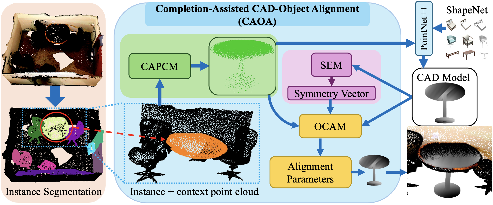

# CAOA: Completion-Assisted Object-CAD Alignment

**Hiranya Garbha Kumar, Minhas Kamal, Balakrishnan Prabhakaran** · University at Albany, SUNY

*International Conference on 3D Vision (3DV), 2026*

[](https://doi.org/10.1109/3DV69130.2026.00047)
[](https://arxiv.org/abs/2606.18429)
[](https://doi.org/10.5281/zenodo.24121532)



Official implementation of **CAOA**, which aligns CAD models to the objects of indoor RGB-D scans: for each object,
it estimates a 9-DoF pose (position, rotation and scale along three axes) that places a ShapeNet CAD model on it.
Real scans are noisy and incomplete, and instance segmentation errors distort the objects further. CAOA therefore
completes each object's point cloud before aligning, and accounts for the symmetry of the CAD model.

- **Instance segmentation** (SoftGroup or SphericalMask) extracts each object and its surrounding context points.
- **CAPCM** (Context-Aware Point Cloud Completion Module) completes the object's partial point cloud.
- **SEM** (Symmetry Encoder Module) turns points sampled from the CAD model into a symmetry vector.
- **OCAM** (Object–CAD Alignment Module) estimates the alignment from the completed points, the CAD points and the
  symmetry vector.
- **CAD retrieval** proposes the candidate models. This implementation uses a learned joint embedding of scanned
  objects and ShapeNetV2 CADs (the paper uses PointNet++ features). OCAM aligns the top 10 candidates, and the
  best-fitting one is kept.

The paper also introduces **S2C-Completion (S2C-C)**: 8,500+ expert-annotated object–CAD pairs from Scan2CAD, a
real-world benchmark for single-object completion.

## Results

Alignment on the S2C-C val set, mean ± std over 3 seeds. The metric is Scan2CAD's per-object criteria (20 cm / 20° /
20%) applied to the predicted box: % of objects passing, instance mean.

| Instances | Alignment accuracy | Objects evaluated |
|---|---|---|
| Ground truth | 84.21 ± 0.31 | 1,864 |
| SphericalMask | 83.73 ± 0.26 | 1,762 (94.5%) |
| SoftGroup | 84.26 ± 0.38 | 1,453 (78.0%) |

[`docs/RESULTS.md`](docs/RESULTS.md) has every table of the paper next to this implementation's numbers, the
evaluation protocol, and the ablations. The full tables, generated by `scripts/report.py`, are in
[`docs/results/tables.md`](docs/results/tables.md).

## Status

| Milestone | Status |
|---|---|
| Code: CAPCM, SEM, OCAM, CAD retrieval, full pipeline, evaluation | ✅ released |
| Trained models (all variants, 3 seeds) and data on Zenodo | ✅ released ([doi:10.5281/zenodo.24121532](https://doi.org/10.5281/zenodo.24121532)) |
| Paper results reproduced ([`docs/RESULTS.md`](docs/RESULTS.md)) | ✅ done |
| Instance predictions (SoftGroup, SphericalMask) from the official checkpoints | ✅ released |
| Single-scan inference script and notebook | ✅ released |
| SN-Indoor generation script (synthetic partial scans for CAPCM training) | ⏳ pending |

## Setup

### 1. Code

```bash
git clone https://github.com/kumarhiranya/caoa.git && cd caoa
uv sync --extra train          # Python 3.12, torch 2.9.1 + cu126, spconv-cu126 (add --extra notebook for the notebook)
uv run pytest -q               # unit tests; the data-dependent ones skip without the data
```

### 2. Trained models and data

Trained models and data are on Zenodo ([doi:10.5281/zenodo.24121532](https://doi.org/10.5281/zenodo.24121532),
CC BY-NC 4.0). Each archive extracts into the repository root, where the default `configs/paths.yaml` expects it.

| Archive | Size | Contents |
|---|---|---|
| `caoa_models_v1.tar.zst` | 3.3 GB | `release_v1/`: every trained model with config and results: 3 CAPCMs, SEM, 7 OCAM variants × 3 seeds, retrieval + ShapeNetV2 database embeddings |
| `caoa_models_v1_pipeline.tar.zst` | 364 MB | only the models the pipeline runs (CAPCM, SEM, final OCAM, retrieval); enough for `align_scene.py` and the notebook |
| `caoa_data_v1.tar.zst` | 134 MB | `data/`: S2C-C annotations (ScanNet instance per Scan2CAD model), CAD splits, semantic embeddings, SoftGroup and SphericalMask predictions on the ScanNet val scans; `cache/`: SEM embeddings |

```bash
scripts/download.sh all data                # or: pipeline data. Downloads, checks SHA-256, extracts -> release_v1/, data/, cache/
uv run python scripts/unpack_release.py     # links the models into outputs/ under the run names the scripts use
```

The archives contain no ScanNet, ShapeNet or Scan2CAD data, as those datasets' terms don't allow redistribution. The
data built from them is generated locally in step 4.

### 3. Datasets (download them yourself, under their terms)

| Dataset | Where | Put it at (default paths) | Needed for |
|---|---|---|---|
| ScanNet v2 | [scan-net.org](http://www.scan-net.org) (terms of use form) | `data/scannet/scans/<scene>/`: `<scene>_vh_clean_2.ply`, `_vh_clean_2.0.010000.segs.json`, `.aggregation.json` of the 1,506 Scan2CAD scenes | everything |
| ShapeNetCore v2 | [shapenet.org](https://shapenet.org) | `data/ShapeNetV2/` | everything (CAD meshes, retrieval database) |
| Scan2CAD annotations | [github.com/skanti/Scan2CAD](https://github.com/skanti/Scan2CAD) (form) | `data/scan2cad/full_annotations.json`, `cad_appearances.json` | everything |
| SN-Indoor partial scans | generated from ShapeNetCore v2 (generation script pending, see Status) | `data/ShapeNetV2-augmented/`, split file in `data/ShapeNetV2/` | CAPCM training only |

Paths can be changed in `configs/paths.local.yaml` (copy of `configs/paths.yaml`).

### 4. Build the derived data

```bash
# S2C-C annotations = Scan2CAD's annotations + the ScanNet instance of each aligned model (from the data archive)
uv run python scripts/build_s2cc_annotations.py --scan2cad data/scan2cad/full_annotations.json \
    --instance-ids data/s2cc/s2cc_instance_ids.json --out data/s2cc/scan2cad_v2_completion_annotations.json
uv run python scripts/build_pairs.py                         # object–CAD pairs from ScanNet (~550 MB)
uv run python scripts/build_cad_points.py                    # CAD points for OCAM (~290 MB)
uv run python scripts/build_shapenet_points.py               # ShapeNetV2 retrieval database (~1.3 GB)
uv run python scripts/build_pose_completions.py --name capcm_concat --run outputs/capcm_concat   # GPU (~800 MB)
# only for the completion benchmark and CAPCM training:
uv run python scripts/build_completion_cache.py --radius 0   # ~2.0 GB
uv run python scripts/build_completion_cache.py --radius 1   # ~2.8 GB
```

`scripts/report.py` regenerates every table from the released results straight away; the evaluation commands below
recompute them. Instance predictions can also be made from scratch:
[`docs/instance_predictions.md`](docs/instance_predictions.md).

## Aligning CAD models to a scan

```bash
uv run python scripts/align_scene.py --release release_v1 --ply <scene>_vh_clean_2.ply \
    --instances <scene>_sg_preds.npz --out <scene>.json [--conf 0.3] [--search class|all] [--scan-trs trs.json]
```

For each instance, the output JSON gives:
- the retrieved ShapeNetV2 model;
- its pose: `cad_to_scan`, `cad_to_world`, and a Scan2CAD-style `trs`;
- the predicted oriented box.

The script needs ShapeNetCore v2 for the candidate meshes, and a GPU.

[`notebooks/single_scene_pipeline.ipynb`](notebooks/single_scene_pipeline.ipynb) runs the same pipeline stage by stage on
one scan and draws each stage as an interactive plotly figure:
- the input scan;
- instance segmentation;
- completion;
- retrieval;
- SEM symmetry;
- alignment and re-ranking of every candidate;
- the full output scene;
- for annotated val scenes, the result against the S2C-C ground truth.

The notebook is stored without outputs. A scene takes about 30 s on an A100.

## Training and evaluation

Each step writes `outputs/<name>/` (config, logs, checkpoints, `results.json`).

```bash
# models
uv run python scripts/train_completion.py configs/capcm/concat.yaml               # CAPCM (also s2cc, s2cc_context100)
uv run python scripts/build_pose_completions.py --name capcm_concat --run outputs/capcm_concat
uv run python scripts/train_sem.py                                                # SEM
uv run python scripts/build_sem_embeddings.py --checkpoint outputs/sem/model_recalibrated.pth
uv run python scripts/train_pose.py configs/ocam/final.yaml [--seed 778]          # OCAM (also the configs/ocam/ ablation)
uv run python scripts/train_retrieval.py configs/retrieval/retrieval.yaml         # CAD retrieval

# evaluation
uv run python scripts/train_pose.py configs/ocam/final.yaml --eval-only outputs/ocam_final/model_final.pth   # OCAM, GT instances
uv run python scripts/rerank_retrieval.py                                         # retrieval + re-ranking, GT instances
uv run python scripts/run_pipeline.py --instances sphericalmask [--pose ocam_final]   # full pipeline (also softgroup)
uv run python scripts/run_pipeline.py --instances softgroup --tag _common --restrict-to outputs/pipeline_sphericalmask__ocam_final
uv run python scripts/report.py                                                   # all tables
```

## Evaluation protocol

- **Data:** the S2C-C annotations; the val set has 1,864 objects.
- **Predicted instances:** only S2C-C objects matched by a prediction are scored (point IoU ≥ 0.5, one-to-one,
  confidence ≥ 0.3). Unmatched objects and predictions are not failures; the capture rate reports coverage.
- **Metrics:**
  - **S2C box:** Scan2CAD's per-object criteria (20 cm / 20° / 20%, symmetry-aware) applied to the predicted box.
    This is the headline metric. It doesn't depend on which CAD was retrieved.
  - **CAOA:** the metric of the paper's tables, computed in each object's normalised frame.
  - **S2C criteria:** Scan2CAD's criteria applied to the placed CAD itself.

## Layout

- `caoa/data`: ScanNet scenes, Scan2CAD annotations, object–CAD pairs, completion and pose datasets, instance
  predictions, ShapeNet.
- `caoa/eval`: the CAOA metric, Scan2CAD's benchmark and per-object criteria, the box criteria, completion metrics.
- `caoa/models`: OCAM (spconv), CAPCM (UpTrans), SEM (Point Transformer V3), losses.
- `caoa/retrieval`: the retrieval embedding, search, and the retrieve–align–re-rank pipeline.
- `caoa/inference.py`, `caoa/viz.py`: the single-scan pipeline and its plots.
- `configs/`: `capcm/`, `ocam/` (the final model and the ablation), `retrieval/`, and the paths files.

## Citation

```bibtex
@inproceedings{kumar2026caoa,
  title     = {{CAOA} -- Completion-Assisted Object-{CAD} Alignment},
  author    = {Garbha Kumar, Hiranya and Kamal, Minhas and Prabhakaran, Balakrishnan},
  booktitle = {International Conference on 3D Vision (3DV)},
  year      = {2026},
  doi       = {10.1109/3DV69130.2026.00047}
}
```

## Acknowledgements

This material is based upon work supported by the National Science Foundation (NSF) under Grant Nos. 2603236 and
2532731. CAOA builds on ScanNet, ShapeNet, Scan2CAD, ODGNet, Point Transformer V3, SoftGroup and SphericalMask.

## License

Code: MIT ([`LICENSE`](LICENSE)), except the files adapted from third-party code listed in
[`THIRD_PARTY_LICENSES.md`](THIRD_PARTY_LICENSES.md), which keep their licenses, some of them non-commercial. Trained
models and data (Zenodo): CC BY-NC 4.0. ScanNet, ShapeNet and Scan2CAD remain under their own terms.
